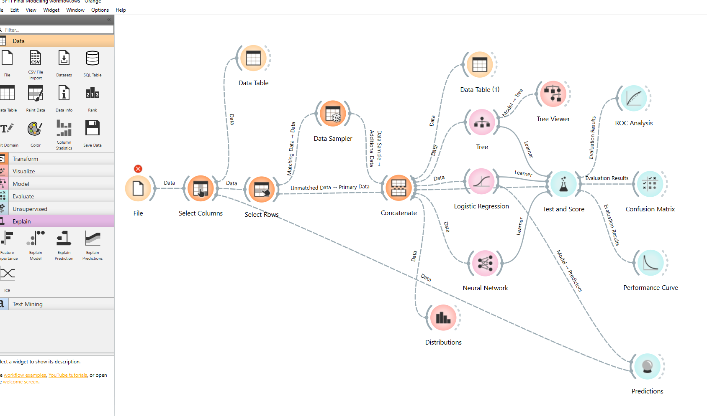
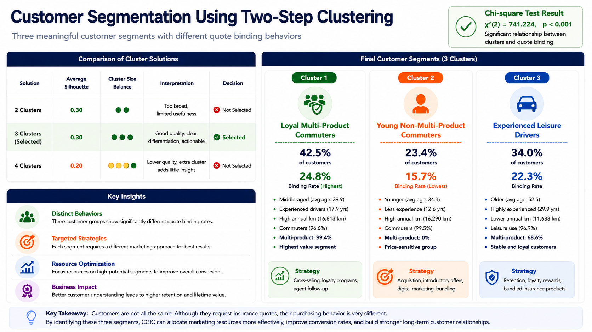

# Project Screenshots and Visualizations

This folder contains three visualizations from my MBA Business Analytics project at Brock University (2026).

The images illustrate the machine learning workflow, predictive model evaluation, and customer segmentation results.

## 1. Machine Learning Workflow in Orange

**Figure 1. Orange Data Mining Workflow**

The workflow includes:
- Data selection and sampling
- Decision Tree, Logistic Regression, and Neural Network models
- Model evaluation using Test & Score
- ROC Analysis and Confusion Matrix
- Performance visualization and prediction analysis

This workflow demonstrates how different models were developed, tested, and compared.

---

## 2. Predictive Model Performance Comparison

**Figure 2. Final Model Evaluation Results**

| Model | AUC | Accuracy | F1 | Precision | Recall | MCC |
|---|---:|---:|---:|---:|---:|---:|
| Decision Tree | 0.626 | 0.597 | 0.620 | 0.586 | 0.658 | 0.195 |
| Logistic Regression | 0.634 | 0.597 | 0.618 | 0.588 | 0.652 | 0.196 |
| Neural Network | 0.633 | 0.597 | 0.616 | 0.588 | 0.646 | 0.194 |

Logistic Regression was recommended because it achieved the highest AUC (0.634) and provided a practical balance of predictive performance and interpretability.

I also independently used Python to cross-check the three models, obtaining broadly similar results.

---

## 3. Customer Segmentation Results

**Figure 3. Two-Step Clustering and Customer Segmentation**

Three customer groups were identified:

| Customer Segment | Customer Share | Quote Binding Rate |
|---|---:|---:|
| Loyal Multi-Product Commuters | 42.5% | 24.8% |
| Young Non-Multi-Product Commuters | 23.4% | 15.7% |
| Experienced Leisure Drivers | 34.0% | 22.3% |

A Chi-square test indicated a statistically significant relationship between customer segment and quote binding status (p < 0.001).

These findings helped inform customer targeting, cross-selling, and retention recommendations.

---

## 4. Key Learning Outcomes

- Developing and evaluating machine learning workflows
- Comparing multiple classification algorithms
- Independently checking model results using Python
- Interpreting analytical findings for business decisions
- Communicating technical results through visualizations
- Considering data privacy and model limitations

## Privacy Statement

These screenshots present analytical workflows and aggregated results only. No original customer-level insurance records or personally identifiable information are included.

This is an academic project portfolio. The models have not been deployed into production.
